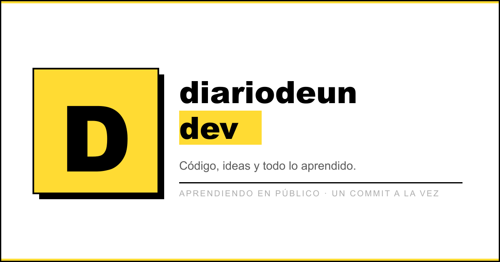

# Diario de un Dev

### Opinión, experiencias y tecnología escritas sin prisa.

[**Leer el blog →**](https://diariodeundev.com)

## Un diario sobre el oficio de crear software

**Diario de un Dev** es mi rincón personal para escribir sobre desarrollo web, inteligencia artificial y todo lo que voy aprendiendo por el camino.

Aquí tienen cabida las decisiones técnicas, los errores que terminan enseñando algo, las ideas todavía a medio formar y la parte menos visible de trabajar como desarrollador. Sin fórmulas mágicas, sin contenido de relleno y sin postureo.

## Qué encontrarás

- Experiencias reales del día a día como desarrollador.
- Reflexiones sobre tecnología e inteligencia artificial.
- Aprendizajes, decisiones y errores construyendo productos.
- Opinión personal sobre cómo cambia nuestro oficio.
- Artículos escritos cuando hay algo que merece la pena contar.

## El blog por dentro

El sitio está construido con **Astro**, artículos en **Markdown y MDX** y una interfaz retro/neobrutalista basada en **RetroUI** y **Tailwind CSS**. Los elementos interactivos utilizan pequeñas islas de **React** y la newsletter se integra con **Resend**.

El despliegue se realiza en **Vercel**, junto con Web Analytics y Speed Insights.

## Enlace

🌐 **[https://diariodeundev.com](https://diariodeundev.com)**

---

Escrito y construido por **Luis**.

