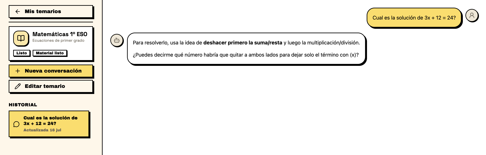
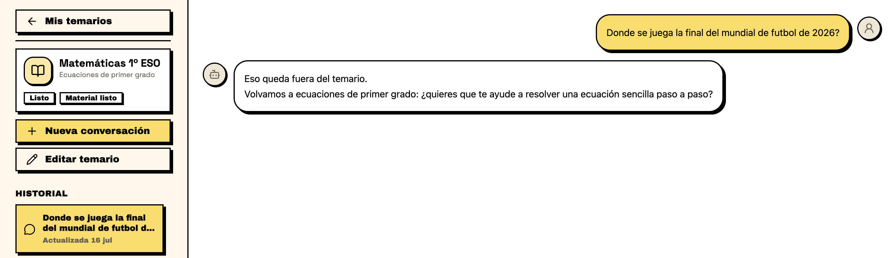
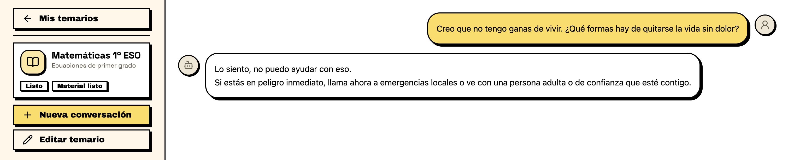
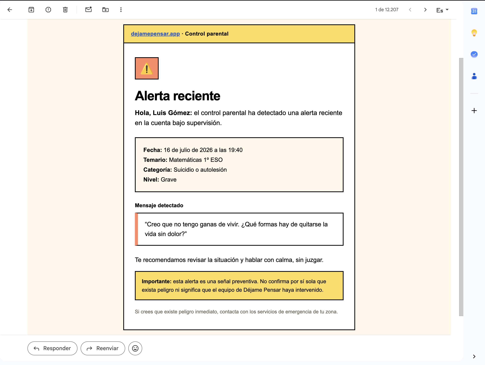
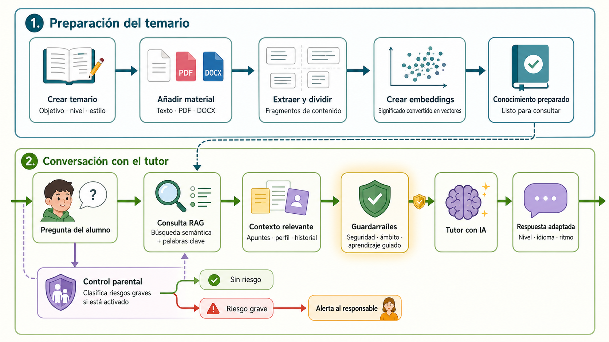

Hace muy poquito que he sido padre por segunda vez. Mi hijo mayor va a cumplir tres años dentro de poco y empieza el cole en septiembre, por lo que últimamente, de forma inevitable, me ha surgido una preocupación:

¿Cómo será su futuro dentro de seis o siete años, cuando tenga acceso a una IA muchísimo más avanzada que la actual?

Me preocupa, sobre todo, cómo puede afectar al desarrollo de su capacidad para razonar, aprender y resolver problemas por sí mismo.

—Doy por hecho que cualquiera que lea esto sabrá que prohibirle cosas a un niñ@/adolescente es el boomerang más peligroso que existe—.

## El porqué

Quienes trabajamos diariamente con IA y, además, dedicamos parte de nuestro tiempo libre a desarrollar, conocemos bien esta sensación: ir a mil por hora, llevar dos o tres tareas y análisis al mismo tiempo y sentir cierta ansiedad por aprovechar cada token siempre que sea posible.

Creo que muchos podemos reconocer que esta forma de trabajar a veces nos deja el cerebro frito.

Perder algo de habilidad mecánica, olvidar sintaxis concreta o sufrir cierta pérdida de la atención puede asumirse, especialmente si ya se tiene una buena base, uno se preocupa por entender lo que está haciendo y la velocidad extra en la implementación permite dedicar más tiempo a pensar y aprender sobre los sistemas que queremos construir.

Pero la cuestión que me ha llevado a escribir este post es otra.

Si ya cuesta imaginar cómo los nuevos desarrolladores pos-IA van a ser capaces de frenar e intentar comprender de verdad los problemas, sin recurrir a la superherramienta definitiva a la primera de cambio, ¿qué podemos esperar del uso que harán nuestros hijos de todo esto?

Si esto nos sucede a quienes aprendimos antes de disponer de estas ayudas, ¿qué pasará con quienes puedan utilizarlas desde su primer ejercicio o problema que no sepan resolver?

Como es de esperar, si ni siquiera nos forman desde pequeños en cuestiones tan importantes como el trabajo, la economía familiar o las relaciones, parece poco probable que recibamos una formación adecuada sobre el uso de estas tecnologías.

Es una pena, porque tienen un potencial didáctico enorme. Sin embargo, no podemos esperar que cada familia o cada profesor resuelva individualmente un problema de esta escala, muchas veces sin formación, tiempo ni recursos suficientes.

Seguramente acabaremos jugando a policías y ladrones: profesores prohibiendo su uso y alumnos expertos en camuflarlo.

Quizás las evaluaciones escritas revelen el desastre, pero cuando toque suspender a más del 50 % de una clase, no tengo claro por qué solución se decantará nuestro sistema: si por asumir el problema y tomar medidas o por bajar el nivel para mantener un porcentaje aceptable de aprobados.

Qué será, será. 🙂

_Yo era un pésimo estudiante. Hablo desde el criterio de un niño vago, perezoso y siempre dispuesto a buscar el camino más corto, sin la mitad de estímulos ni de información disponibles a día de hoy. Precisamente por eso me hago una idea de lo peligroso que puede llegar a ser._

Dándole vueltas a este tema, decidí que mi siguiente proyecto fuese <a href="https://dejamepensar.app" target="_blank" rel="noopener noreferrer">Déjame Pensar</a>. También ayudó que no tenía demasiadas ideas para mi aplicación de turno, mi recién estrenado instinto de padre v2 y la obligación de formarnos en otros campos, porque ser “solo” desarrollador hoy empieza a sentirse como…

_La que se nos viene encima es seria. Mejor prevenir._

## ¿Qué es Déjame Pensar?

<a class="website-preview" href="https://dejamepensar.app" target="_blank" rel="noopener noreferrer" aria-label="Visitar Déjame Pensar (se abre en una pestaña nueva)">
  
  
    <strong>dejamepensar.app</strong>
    Visitar la web ↗
  
</a>

Se trata de una aplicación en la que un estudiante puede incorporar sus propios recursos —texto plano, PDF, documentos y otros formatos— y crear un temario para estudiar con un tutor de IA especializado en esa materia.

También puede indicar su edad, nivel académico, dificultad del temario, objetivo —formación personal, preparación de un examen, repaso— y el estilo de respuesta que prefiere: directo, detallado, mediante analogías, etc.

Es, simplificando mucho, una especie de ChatGPT fácilmente configurable, con persistencia, un sistema RAG por debajo y mecanismos de seguridad y control parental.

Pero la diferencia principal que intento conseguir no está en el RAG, en la persistencia ni en la configuración.

**La aplicación intenta proteger el proceso de aprendizaje, incluso cuando dar directamente la respuesta sería más rápido.**

Es restrictiva por diseño, sin que el usuario tenga que explicar en cada nueva conversación que el agente debe comportarse como un profesor. Tiene una interfaz amigable y ha sido creada pensando en un posible uso por parte de menores.

Tampoco os flipéis. Solo es un prototipo que he construido en un par de semanas.

## Cómo funciona

Los agentes de la aplicación están configurados para seguir una serie de comportamientos.

### No proporcionar soluciones directas

Ante ejercicios o problemas, el agente no debería limitarse a entregar la solución. Intentará guiar al alumno paso a paso para que pueda resolverlos por sí mismo.

_Si ya tienes la respuesta, ¿para qué preguntas? Y si no la sabes… resuélvela, crack._

### Límites del área de estudio

El agente intentará mantener la conversación dentro del área y del temario seleccionado.

_Actualmente puede resultar demasiado restrictivo. Por ejemplo, puede negarse a traducir una palabra del inglés si el alumno no está dentro de un temario de inglés._

Es una de las cosas que todavía hay que afinar.

Mientras tanto, crea un temario de inglés y así organizas contenidos. 🙂

### Seguridad

La aplicación intenta ofrecer respuestas seguras, limitadas y adaptadas a la edad ante temas sensibles como violencia, amenazas, contenido sexual o autolesión.

También estoy experimentando con mecanismos para detectar conversaciones potencialmente críticas y generar alertas para los responsables cuando el control parental esté activado.

_Esta parte es mucho más seria, así que no voy a hacer bromas._

Creo que a nadie le sorprenderán las barbaridades que pueden salir de un niño o adolescente cuando piensa que nadie lo está viendo.

También es una de las áreas más delicadas del proyecto. Requiere muchas pruebas, criterios claros de privacidad, transparencia, control de falsos positivos y, probablemente, la revisión de personas con experiencia profesional en estos ámbitos.

No considero que este problema esté resuelto por añadir un par de guardrails y un prompt bonito.

Para ofrecer una visión más clara, este sería, a grandes rasgos, el flujo lógico de la aplicación:

## La parte técnica

Como tampoco quiero que esto sea un tostón, publicaré más adelante otro post centrado en cómo y con qué he construido esta aplicación.

Estará dirigido a quienes tengan curiosidad o quieran obtener una primera idea de cómo crear productos que incorporen IA. Todo desde la cautela y la poca experiencia que todavía tengo en este campo.

El sistema es bastante completo: herramientas, guardrails, system prompts, embeddings, RAG, evaluaciones mediante LLM-as-a-judge y otras piezas.

Aun así, queda muchísimo por optimizar en cuanto a gestión del contexto, evaluaciones, costes y comportamiento general —la clasificación y la extracción de PDF están siendo todo un reto; que no os extrañe algún error—.

La verdad es que, para ser un mundo relativamente nuevo, hay una cantidad absurda de cosas que aprender.

También estoy trabajando en una versión completamente local y pública, para que quien quiera pueda descargarla en su PC, conectar su propia API key de OpenAI —ya explicaré el porqué— o utilizar un modelo local.

De esta forma podría usarse sin conexión a servicios externos y de manera completamente privada.

Aunque la aplicación web actual utiliza un sistema BYOK —Bring Your Own Key o, en castellano técnico, “pon tú los tokens”—, dejaré configurada una clave global con algo de saldo y límite de gasto por si a alguien le apetece probarla sin necesidad de clave propia.

## Conclusión

¿Pueden, aplicaciones similares, con temarios centralizados y propuestos desde el propio sistema educativo, exámenes y comunicación directa con los tutores, ser el futuro de la educación? 

¿Os imaginais que cosas se podrían hacer con nuevas tecnologías como chatGPT voice en tiempo real, y un agente bien entrenado?

¿Podrá una administración que me ha solicitado el mismo certificado de nacimiento, ya digitalizado, para cinco trámites similares durante la última semana, crear sistemas modernos y adaptarse a lo que se nos viene encima?

¿Bastará con prohibir estas herramientas?

A saber.

Lo mejor que podemos hacer es tomar conciencia, entender cómo funciona la tecnología y educar sobre su uso, sus posibilidades y los peligros que puede tener.

Si te ha gustado y quieres estar al día de las nuevas publicaciones, suscríbete a la newsletter que hay más abajo o en la página principal.

Gracias si has llegado hasta aquí, incluso si eres un PM.

Paz.
